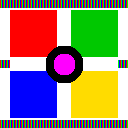
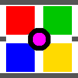
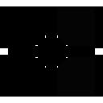

# Лабораторна робота 9. Кодер BC1

## Мета роботи

Реалізувати кодер текстур BC1 на Python + NumPy, порівняти два способи вибору опорних кольорів і знайти зображення, на яких формат дає помітні похибки.

## Хід роботи

1. Я реалізував функцію `make_palette`, яка за двома опорними кольорами будує палітру з чотирьох: `c0`, `c1`, `(2·c0 + c1)/3` і `(c0 + 2·c1)/3`. Для білого й чорного вийшло 255, 0, 170 і 85, форма масиву `(4, 3)`.
2. Я написав `pick_endpoints` у двох режимах: «коробка» (поканальні максимум і мінімум) та «пікселі» (найсвітліший і найтемніший піксель за яскравістю `0,299R + 0,587G + 0,114B`). Потім я реалізував `encode_block`: опорні кольори квантуються до RGB565, будується палітра, а для кожного з 16 пікселів обирається найближчий колір палітри через broadcasting форми `(16, 4, 3)`. Усі тести `lab9.py` пройдені без жодного «НІ».
3. Я прогнав усі чотири тестові зображення обома способами. Результати наведено в таблиці 1.

**Таблиця 1 — RMSE двох способів вибору опорних кольорів**

| Зображення | Коробка | Пікселі | Найкращий з двох |
|---|---|---|---|
| фотографія | 5,71 | 5,66 | 5,54 |
| градієнт | 1,32 | 1,32 | 1,32 |
| нормал-мапа | 11,82 | 10,77 | 9,87 |
| різкі межі | 28,11 | 0,00 | 0,00 |

На різких межах спосіб «пікселі» виграє повністю (0,00 проти 28,11), на фотографії й градієнті різниця практично відсутня. На нормал-мапі «пікселі» кращі в середньому, але гірші в найгіршому випадку (див. нижче). Спосіб «найкращий з двох» (бонусне завдання), який для кожного блоку лишає варіант із меншою похибкою, виявився не гіршим за обидва окремо на всіх зображеннях за RMSE.

4. Для нормал-мапи я виміряв кутову похибку, тобто кут між початковою й відновленою нормаллю (таблиця 2).

**Таблиця 2 — Кутова похибка нормал-мапи**

| Спосіб | Середня, ° | Максимум, ° | Пікселів > 2° |
|---|---|---|---|
| коробка | 7,36 | 29,09 | 89,7 % |
| пікселі | 6,27 | 41,92 | 78,6 % |
| найкращий з двох | 5,99 | 31,75 | 81,4 % |

Для способу «коробка» я отримав 7,36° у середньому, 29,09° максимум, а пікселів із похибкою понад 2° — 89,7 %, що збігається з контрольними значеннями.

5. **Власний випадок поломки.** Я створив піксель-арт зображення 128×128: насичені червоний, зелений, синій і жовтий квадрати на білому тлі, чорне кільце з пурпурною серединою та, зверху й знизу, смуги з вузьких стовпчиків червоного, зеленого й синього кольорів (по 1 пікселю). Межі фігур не кратні 4, тому потрапляють усередину блоків.

   Результат: «коробка» — RMSE 44,31, максимальна похибка 170, середня 15,54, PSNR 15,2 дБ; «пікселі» — RMSE 39,54, максимальна похибка 255, середня 8,07, PSNR 16,2 дБ. Для порівняння, на фотографії RMSE лише 5,71.

| Оригінал | Після BC1 (коробка) | Карта різниці (×3) |
|---|---|---|
|  |  |  |

## Відповіді на запитання

### Запитання 2. Чому блок із червоного, зеленого й синього не може бути стиснутий без великої похибки?

Усі чотири кольори палітри BC1 лежать на одному відрізку між двома опорними кольорами. Чистий червоний, чистий зелений і чистий синій розташовані в різних кутах простору RGB, тож жодна пряма не проходить через усі три. Відрізок можна провести через два кольори, але третій опиниться далеко від нього, і його замінить найближчий колір палітри, зазвичай якийсь відтінок сірого чи суміш двох інших. Похибка при цьому велика, і це властивість формату, а не вада кодера.

### Запитання 3. Чому на різких межах способи дали 28,11 і 0,00?

На межі смуг у блоці зустрічаються, наприклад, червоні й зелені пікселі. «Коробка» бере максимум і мінімум по кожному каналу окремо: максимум дає жовтий (255, 255, 0), мінімум — чорний, і жодного з цих пікселів у блоці немає. Червоний і зелений опиняються десь посередині відрізка між жовтим і чорним та перетворюються на брудно-оливковий. Спосіб «пікселі» бере найсвітліший і найтемніший реальні пікселі, тобто саме червоний і зелений. Обидва кольори стають опорними й відновлюються точно, тому похибка нульова. У тестових смугах у кожному блоці лише два різні кольори, що й дає 0,00.

### Запитання 5. Чому нормал-мапа складніший випадок, якщо її RMSE (11,8) менший, ніж у різких меж (28,1)?

RMSE міряє різницю байтів у каналах, а в нормал-мапі канали кодують напрямок. Невелика різниця в байтах може означати помітний поворот нормалі, і RMSE цього не показує. Кутова похибка показала, що середня похибка становить 7,36°, а 89,7 % пікселів відхиляються більш ніж на 2°. Освітлення, пораховане по такій мапі, буде неправильним майже скрізь, просто рівномірно, тому око списує це на стиль. На різких межах помилка велика, але локальна й помітна, а в нормал-мапі вона розподілена по всьому зображенню й непомітна на вигляд.

## Висновки

Я реалізував кодер BC1 і переконався, що кожен блок 4×4 стискається до восьми байтів незалежно від вмісту. Формат добре працює для плавних зображень, де пікселі блоку лежать уздовж прямої, і ламається, коли в блоці є три й більше різних кольорів. Універсально найкращого способу вибору опорних кольорів немає: «пікселі» виграють на різких межах, але гірші в найгіршому випадку на нормал-мапі, а вибір кращого з двох варіантів для кожного блоку дає найменшу похибку.